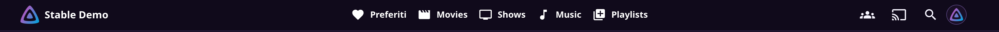
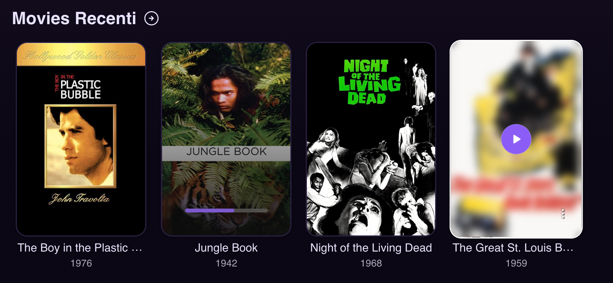
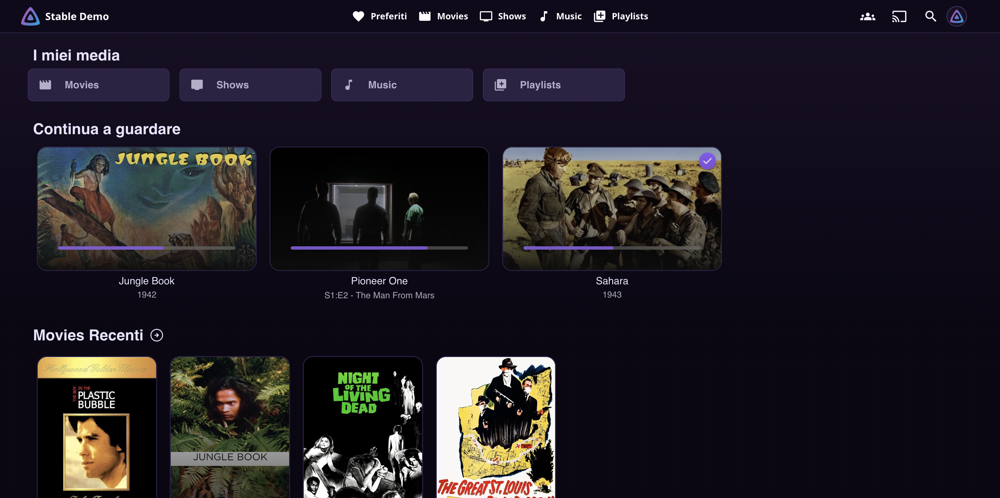
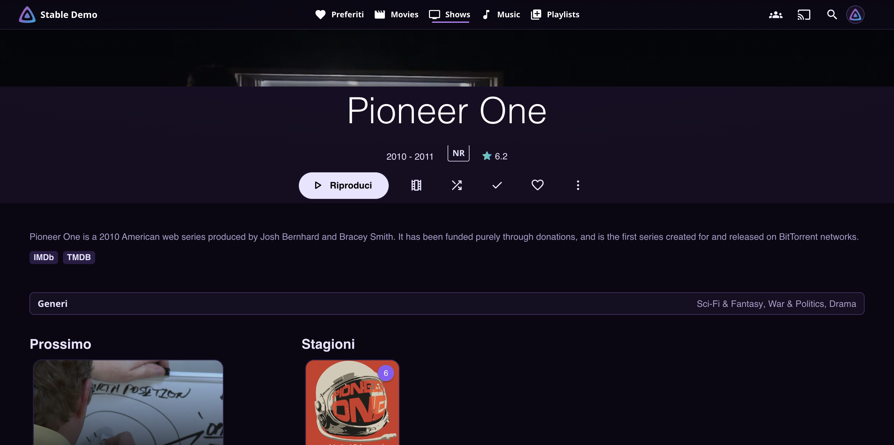
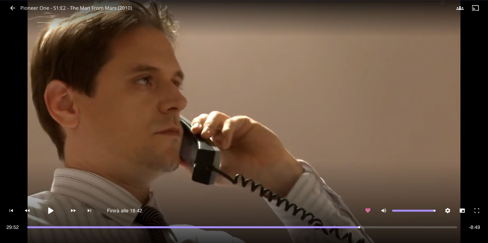

# 💜 Amethyst — a purple & violet theme for Jellyfin


**Amethyst** turns Jellyfin into a cinematic, Apple TV / Netflix-inspired
experience in **purple & violet**. The design base is
**[ElegantFin](https://github.com/lscambo13/ElegantFin)** (embedded — the theme
is fully self-contained), re-mapped to the Amethyst palette and refined with
custom details: an animated navbar, curated progress bars and indicators, and
a polished player.

> The **only** external stylesheet loaded is the
> [Intro-Skipper button CSS](https://github.com/intro-skipper/intro-skipper-css).

---

## ✨ What you get

| | |
|---|---|
| 🟣 **Full purple/violet palette** | Every color variable of the base theme + Jellyfin 12's MUI surfaces (`--jf-palette-*`) |
| 🎬 **Animated navbar** | Server name pinned left, options centered; soft-purple underline that **grows from the center on hover** and reverses on leave; permanent underline on the active view |
| 🃏 **Curated cards** | Violet progress bars everywhere (home **and** library pages), violet play buttons, watched flags, count badges |
| 📺 **Polished player** | White OSD icons with a violet halo on hover, violet seek bar, glowing Skip Intro button |
| 🖼️ **Clean library tiles** | "My Media" shows artwork only — no labels |
| 📱 **Responsive detail page** | Buttons never leave the screen: full-width on phones, stacked on tablets |

## 🎨 Palette

| Role | Color |
|---|---|
| Background (deepest) | `#0b0714` |
| Surface | `#191026` |
| Accent (violet) | `#8b5cf6` |
| Accent hover | `#a78bfa` |
| Soft accent (underline) | `#c084fc` |
| Text | `#e9e4ff` |
| Dim text | `#a99cc9` |

## 📸 Screenshots

> Drop your captures in a `screenshots/` folder with these exact names and
> they will render here.

| | |
|---|---|
|  |  |
| *Navbar — centered options, underline on hover & active view* | *Cards — centered violet play button on hover* |
|  |  |
| *Home — artwork-only library tiles* | *Detail page — pill buttons* |
|  | 
| *Player OSD — violet seek bar, icon hover halo* | 

## 🎞️ Animations

| Where | What happens |
|---|---|
| **Navbar — hover** | A soft-purple underline grows from the center of the tab and **reverses** when the mouse leaves (0.25s ease) |
| **Navbar — selection** | The underline animates in and stays while you're inside that library |
| **Cards — hover** | The play button scales in from the exact center of the artwork (it stays centered even mid-hover) |
| **Player icons — hover** | A violet halo + outer glow fades in around the icon with a gentle lift; pressing sinks it slightly |
| **Skip Intro** | A violet progress sweep runs across the button until the intro ends |

## 📦 Installation

### Option A — via CDN (recommended, auto-updates)

1. Dashboard → **Branding** → **Custom CSS** → paste:

```css
@import url("https://cdn.jsdelivr.net/gh/LucioDev404/amethyst-jellyfin-theme@main/theme.css");
```

2. Save, then hard-refresh the client (`Ctrl+Shift+R`)

> jsDelivr caches `@main` for ~12 hours — append `?v=N` to the URL to force
> an update after pushing changes.

### Option B — paste everything

Copy the whole content of [`theme.css`](theme.css) into
Dashboard → **Branding** → **Custom CSS** and save.

## 🖥️ Requirements

- Jellyfin **10.11+** (tested on 12.x) — web client + mobile apps
- Client theme set to **Dark**

## 🎛️ Customization

All colors live in the single `:root[data-theme]:root, html:root` block in the
**AMETHYST OVERRIDES** section at the bottom of [`theme.css`](theme.css) —
edit the hex values and reload. Do not edit the embedded base theme section.

> Note: the **Inter webfont** import that ships with ElegantFin was removed
> (single-import policy) — text uses the system sans-serif instead.

## 🙏 Credits & License

- Base theme: [ElegantFin](https://github.com/lscambo13/ElegantFin) — © lscambo13, **GPL-2.0** (embedded)
- Skip button: [intro-skipper-css](https://github.com/intro-skipper/intro-skipper-css) (loaded via CDN)
- Amethyst overrides: **GPL-2.0** — see [LICENSE](LICENSE)
